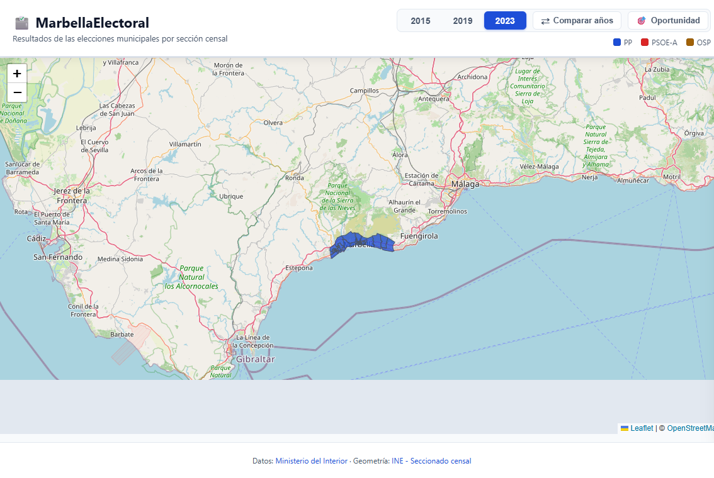

# MarbellaElectoral 🗳️🗺️

Visualizador web de resultados electorales de las elecciones municipales de Marbella, con comparativa entre
convocatorias (2015, 2019, 2023).



## ✨ Qué hace

- **Mapa coroplético** de Marbella: cada sección censal se colorea según el partido ganador.
- **Selector de año** (2015 / 2019 / 2023) en la cabecera.
- **Modo comparativa** (panel lateral): para una sección, muestra la evolución 2015→2019→2023 con deltas en
  puntos porcentuales.
- **Modo oportunidad** (panel lateral + coropleta de rampa): eligiendo un partido, calcula y rankea las
  secciones donde el esfuerzo es más efectivo para pasar al siguiente partido — combinando **votos mínimos
  para adelantar** y **ratio de dificultad** (gap ÷ abstención potencial). Las secciones se colorean con la
  rampa de intensidad del color del partido (muy fácil → muy difícil), con secciones ganadas en tono neutro y
  secciones sin candidatura en gris.
- **Click en una sección** → panel con resultados completos (candidaturas, votos, %, participación).
- Datos oficiales del **Ministerio del Interior** + geometría de **INE**.

### 🎯 Modo oportunidad en detalle

Pensado para responder a la pregunta: _"¿en qué secciones vale más la pena invertir esfuerzo para que mi
partido escale posiciones?"_. Elige un partido y el modo calcula dos métricas por sección, ordenando el
ranking por la más fácil de "ganar".

#### Activación

1. Click en el botón **🎯 Oportunidad** de la cabecera (junto a "Comparar años"). Los modos son **mutuamente
   exclusivos**: activar Oportunidad desactiva Comparativa y viceversa.
2. Aparece el selector **Partido** con todos los partidos del año activo que obtuvieron algún voto, ordenados
   por total de votos descendente (con su total entre paréntesis).
3. La leyenda cambia de la paleta de ganadores a la **rampa de dificultad**:
   - `muy fácil (≤20%)` · `fácil (≤40%)` · `medio (≤70%)` · `difícil (>70%)` · `ya ganada` ·
     `sin candidatura`.

#### Métricas por sección (panel lateral)

| Columna     | Significado                                                                                                                                           |
| ----------- | ----------------------------------------------------------------------------------------------------------------------------------------------------- |
| **Sección** | Distrito + sección censal (`D01-001`, etc.)                                                                                                           |
| **Líder**   | Partido que actualmente gana esa sección (color e insignia del partido)                                                                               |
| **Pos.**    | Posición del partido elegido en esa sección (`2º`, `3º`, …)                                                                                           |
| **↑ Sig.**  | **Votos para pasar al siguiente partido** (el inmediatamente superior). `0` si hay empate.                                                            |
| **↑ 1º**    | Votos para ganar la sección (diferencia con el líder). `—` si el partido ya es 1º.                                                                    |
| **Reserva** | `censo − votantes` = ciudadanos del censo que **no fueron a votar** (abstención). Es la "bolsa" de votos movilizables.                                |
| **Dif.**    | `↑ Sig. ÷ Reserva` = **dificultad**, expresada en %. Cuanto menor, más fácil movilizar los votos que faltan de la abstención. `—` si la reserva es 0. |
| **Part.**   | Participación de la sección (`votantes / censo`)                                                                                                      |

#### Criterios de orden (botones en la cabecera del panel)

- **Dificultad (vs abstención)** — _defecto_. Ordena por `Dif.` ascendente: las secciones más asequibles (más
  fácil "comprar" los votos que faltan de la bolsa de no-votantes) aparecen arriba. Es la vista
  **estratégica** para movilización.
- **Votos para adelantar** — Ordena por `↑ Sig.` ascendente: las secciones donde necesitas menos votos
  absolutos para pasar al siguiente partido, independientemente de la abstención. Es la vista **táctica** para
  un esfuerzo limitado en papeletas/voluntarios.

#### Casos del ranking

- **Secciones "asequibles"** (ranking principal, top 15 con botón "Ver todas"): el partido **no es 1º** y la
  sección tiene censo y candidatos reales (se descartan las secciones sin electores).
- **"A defender"** (panel inferior): secciones donde el partido **ya es 1º**, ordenadas por margen en votos
  sobre el 2º. Indica dónde hay que proteger la ventaja.
- **"Sin candidatura"** (gris tenue en el mapa): el partido no se presentó en esa sección. Excluidas del
  ranking.

#### Mapa en este modo

- **Rampa de color del partido**: la opacidad del color del partido elegido va de `0.85` (muy fácil) a `0.40`
  (difícil) según la dificultad calculada.
- **Tono neutro** del color del partido: secciones ya ganadas.
- **Gris muy tenue**: secciones donde el partido no se presenta.
- El **tooltip** del hover muestra los votos y la pp que faltan para adelantar, en vez del ganador.

#### Navegación

- **Click en una fila** del ranking → centra el mapa en esa sección y abre el panel de detalle estándar.
- El panel de detalle muestra un botón **← Volver al ranking de oportunidad** arriba (solo en este modo) para
  regresar al ranking con el mismo partido, año y criterio seleccionados.
- El modo es por sesión: al cambiar de año se recalculan las filas y se refresca el selector; al recargar la
  página se desactiva.

## 🏗️ Arquitectura

```
data/raw/        ZIPs descargados de infoelectoral.interior.gob.es
data/ine/        Shapefile del seccionado censal (INE)
data/processed/  CSVs intermedios + GeoJSON finales por año
scripts/         Pipeline Python (01_download → 05_normalize)
web/             Frontend estático (Leaflet)
```

## 🚀 Instalación

```bash
# 1. Crear entorno virtual (opcional pero recomendado)
python -m venv venv
.\venv\Scripts\activate

# 2. Instalar dependencias
pip install -r requirements.txt
```

## ▶️ Ejecución

### Pipeline completo (descarga + procesa + genera GeoJSON)

```bash
python run_all.py
```

O paso a paso:

```bash
python scripts/01_download.py        # Descarga ZIPs 2015/2019/2023
python scripts/02_parse_dat.py        # Parsea .dat, filtra Marbella
python scripts/03_load_ine.py         # Carga shapefile INE
python scripts/04_join.py             # Une geometría + resultados
python scripts/05_normalize.py        # Normaliza candidaturas y colores
```

### Servir la web localmente

```bash
cd web
python -m http.server 8000
# Abre http://localhost:8000
```

## 📊 Datos

- **Resultados electorales**:
  [infoelectoral.interior.gob.es](https://infoelectoral.interior.gob.es/es/elecciones-celebradas/area-de-descargas/)
  — apartado "Elecciones a municipios de más de 250 habitantes".
  - API usada:
    `https://infoelectoral.interior.gob.es/min/archivos/extraccion?tipoConvocatoria=4&idConvocatoria={YYYYMM}`
  - Auth Basic (credenciales públicas del portal): `apiInfoelectoral:apiInfoelectoralPro`
- **Geometría de secciones censales**:
  [INE - Seccionado censal 2023](https://www.ine.es/dyngs/DAB/index.htm?cid=1389).

## 🎨 Paleta de partidos

| Siglas                  | Color    | Hex       | Notas                    |
| ----------------------- | -------- | --------- | ------------------------ |
| PP                      | Azul     | `#1d4ed8` |                          |
| PSOE / PSOE-A           | Rojo     | `#dc2626` | Mismo color en variantes |
| VOX                     | Verde    | `#16a34a` |                          |
| Cs                      | Naranja  | `#f59e0b` |                          |
| PODEMOS / IU / ADELANTE | Morado   | `#7c3aed` | Coaliciones de izquierda |
| UPyD                    | Lima     | `#a3e635` | Solo 2015                |
| POR MI PUEBLO           | Turquesa | `#0891b2` | Local Marbella           |
| OSP                     | Marrón   | `#a16207` | Local San Pedro          |
| IMPULSA CIUDAD          | Rosa     | `#db2777` | Local Marbella           |
| PA                      | Teal     | `#0d9488` | Partido Andalucista      |
| OTROS                   | Gris     | `#6b7280` | Resto                    |

## 📁 Estructura de cada feature GeoJSON

```json
{
  "type": "Feature",
  "geometry": { "type": "Polygon", ... },
  "properties": {
    "year": "2023",
    "cpro": "29", "cmun": "069", "cdis": "01", "csec": "001",
    "n_mesas": 1,
    "censo": 576, "votantes": 336, "blancos": 5, "nulos": 3, "candidatos": 328,
    "participacion_pct": 58.33,
    "winner_canon": "PP",
    "winner_color": "#1d4ed8",
    "winner_pct": 48.78,
    "results": [
      { "cod": "000006", "siglas": "PP", "denominacion": "PARTIDO POPULAR", "votos": 160, "pct": 48.78, "siglas_canon": "PP", "color": "#1d4ed8" },
      ...
    ]
  }
}
```

## 🗺️ Roadmap

- [x] S0 — Setup del proyecto
- [x] S1 — Pipeline 2023 (descarga, parseo, normalización)
- [x] S2 — Join con INE (secciones censales)
- [x] S3 — Frontend MVP (Leaflet, click → panel)
- [x] S4 — Extender a 2015 y 2019
- [x] S5 — Selector de año, leyenda, paleta consistente
- [x] S6 — Modo comparativa multi-año (panel lateral)
- [x] S8 — Modo oportunidad: ranking de secciones por partido
- [ ] S7 — Geocodificación de colegios electorales (Junta Electoral)

## 🔧 Detalles técnicos

- **Encoding:** los `.dat` del Ministerio están en cp1252 (Windows ANSI). El parser los lee con `cp1252` y los
  CSVs se escriben en UTF-8.
- **Codificación de candidaturas:** los códigos internos del Ministerio (`cod_candidatura`) son números de 6
  dígitos; varían entre años porque cada partido tiene un código distinto en cada convocatoria.
- **Filtro Marbella:** `CPRO=29` (Málaga) + `CMUN=069` (Marbella).
- **Secciones:** en el shapefile INE están como `CDIS` (2 dígitos) + `CSEC` (3 dígitos); en los `.dat` se
  llaman `cdis` + `csec`. El join se hace por la clave `CDIS+CSEC`.

## 📄 Licencia

MIT para el código. Los datos son propiedad del Ministerio del Interior y del INE.
